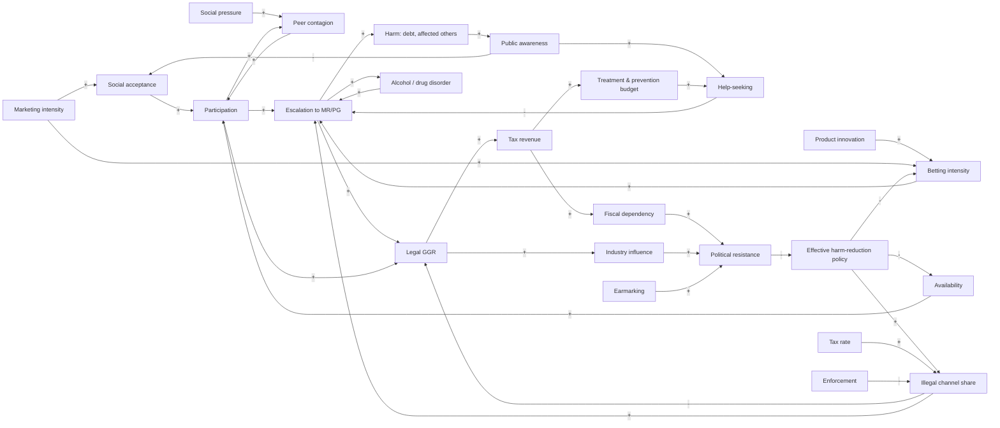

# Checkpoint 2 — Model design

Time step: **1 tick = 1 month**. Horizon 240 ticks (20 years) after a 120-tick hidden burn-in.
Population: 500–5,000 agents; each agent = `adultPopulation / agentCount` real adults (default 10,000,000 adults).

## 1. Causal loop diagram

### Named loops
| ID | Type | Name | Path |
|---|---|---|---|
| R1 | Reinforcing | **Peer contagion** | participation → contagion → participation |
| R2 | Reinforcing | **Normalization** | marketing → acceptance → participation → GGR → marketing budget |
| R3 | Reinforcing | **Fiscal capture** (Policy Resistance) | GGR → tax → dependency → resistance → weaker policy → GGR |
| R4 | Reinforcing | **Lobbying** | GGR → industry influence → resistance → weaker policy → GGR |
| R5 | Reinforcing | **Dual addiction** | gambling escalation ↔ alcohol/drug disorder |
| B1 | Balancing | **Harm visibility** | harm → awareness → lower acceptance → less participation |
| B2 | Balancing | **Treatment** | harm → awareness/help-seeking → treatment → fewer PG |
| B3 | Balancing | **Funded protection** | tax → treatment budget → help-seeking → fewer PG (shrinks the tax base: Shifting the Burden) |
| B4 | Balancing | **Enforcement** | illegal share → enforcement effort → illegal share |
| — | Side-effect | **Fixes that Fail** | strict policy / high tax → illegal channel → higher risk, no tax, no protection |

## 2. Stocks and flows (SD layer, updated once per tick)
| Stock | Range | Inflow | Outflow | Time constant |
|---|---|---|---|---|
| Social acceptance `A` | 0–1 | marketing, participation share | awareness, campaigns | 60 mo |
| Public awareness `W` | 0–1 | visible harm (PG + affected others), campaigns | forgetting | 24 mo |
| Industry influence `L` | 0–1 | legal operator profit | transparency rules | 36 mo |
| Fiscal dependency `D` | 0–30% | tax revenue / public budget (smoothed) | — | 12 mo |
| Political resistance `R` | 0–1 | `D`, `L`, earmarking | — | 6 mo |
| Effective policy (per lever) | 0–1 | lever setpoint × (1 − 0.7·R) | — | 3rd-order delay, 6–18 mo |
| Treatment capacity `C` | slots | treatment budget / cost per slot | — | 12 mo build-up |
| Treatment queue | agents | help-seeking | admissions ≤ free slots | — |
| Illegal channel share `I` | 0–1 | tax rate, strictness | enforcement | 18 mo |
| Fiscal budget | currency | tax revenue | treatment, enforcement, campaigns | — |

## 3. Agent transitions (monthly hazards)
`p = 1 − exp(−rate · dt)`, `rate = base × M`, `M = clamp(exp(Σ βᵢ·xᵢ), 0.1, 10)` where each `xᵢ` is a lever or agent attribute centred so that the status-quo value = 0.

Base hazards (solved so the status-quo steady state matches the calibration targets):

| From → To | Base / month | Main modifiers (+ raises, − lowers) |
|---|---|---|
| Non-gambler → No risk | 0.011 | + availability, acceptance, marketing, peer share × social pressure; − age verification (18–24) |
| No risk → Non-gambler | 0.006 | − acceptance, availability |
| No risk → Low | 0.012 | + intensity (marketing, innovation), product risk, vulnerability, alcohol/drugs |
| Low → No risk | 0.055 | − intensity; + limits, awareness |
| Low → Non-gambler | 0.006 | + awareness |
| Low → Moderate | 0.016 | + intensity, product risk, vulnerability, Pathways subtype, alcohol/drugs, illegal channel |
| Moderate → Low | 0.045 | + deposit/loss limits, affordability checks, awareness; − alcohol/drugs |
| Moderate → Problem | 0.008 | as Low → Moderate, plus debt |
| Moderate → Treatment queue | 0.0012 | + help-seeking (awareness, support, stigma) |
| Problem → Moderate (natural recovery) | 0.024 | + limits, self-exclusion; − in-play, illegal channel, alcohol/drugs |
| Problem → Treatment queue | 0.0055 | + help-seeking (awareness, support, stigma, self-exclusion) |
| Treatment → Recovery | 0.12 | + integrated addiction services |
| Treatment → Problem (dropout) | 0.04 | + alcohol/drugs |
| Recovery → Problem (relapse) | 0.012 | + availability, marketing; − self-exclusion registry |
| Recovery → Moderate | 0.010 | idem |
| Recovery → Non-gambler | 0.025 | + awareness |

Status-quo steady state from these base rates (Markov check): non-gamblers 33.9%, no risk 51.0%, low 10.2%, **moderate 3.6%, problem 1.1% (MR+PG 4.7%)**, treatment+recovery 0.24%; about 19% of problem-gambling exits go through treatment (matches the ~20% help-seeking figure); mean moderate-risk episode is about 18 months (matches Swelogs-style turnover).

### Comorbidity (alcohol and drugs)
Each agent: `alcohol ∈ {none, moderate, disordered}`, `drugs ∈ {none, moderate, disordered}`, with their own small Markov chain driven by the prevalence sliders.
- Disordered alcohol: escalation ×2.2, recovery ×0.6. Disordered drugs: escalation ×2.5, recovery ×0.5.
- Reverse coupling: entering MR/PG raises the agent's alcohol/drug disorder hazard ×2.
- "Integrated services" toggle: treatment success ×1.3 and removes the dropout penalty.
- Targets: ~70% lifetime AUD among PG is not reproduced (that's lifetime, ours is current); we target current AUD among PG ≈ 25–35% (ASSUMPTION, medium-low).

### Pathways subtypes (assigned at birth)
| Subtype | Share | Escalation | Natural recovery | Help-seeking |
|---|---|---|---|---|
| Behaviourally conditioned | 70% | ×1.0 | ×1.2 | ×1.0 |
| Emotionally vulnerable | 20% | ×1.5 | ×0.8 | ×1.3 |
| Antisocial-impulsive | 10% | ×2.2 | ×0.6 | ×0.6 |

### Products
Each gambling agent holds weights over 5 products; risk coefficient = weighted sum.
| Product | Risk coef. | Source |
|---|---|---|
| Lottery | 0.3 | lowest at-risk revenue share (GB study) |
| Sports pre-match | 0.8 | ASSUMPTION |
| Sports in-play | 1.4 | ASSUMPTION; Lancet ~8.9% GD among sports bettors |
| Online casino / slots | 1.8 | Lancet ~15.8% GD among online casino/slot gamblers |
| Land-based EGMs | 1.6 | Ontario: ~60% of machine revenue from PG |

"Product innovation" shifts weights toward in-play and online casino; the in-play ban removes that product.

## 4. Economics
- Monthly spend per agent = `baseSpend × stateMultiplier × intensity`, with state multipliers **NR 1, LR 3, MR 8, PG 25** → at-risk share of GGR ≈ 41% in the status quo (target 40–50%).
- GGR legal = Σ spend × (1 − I); tax = GGR legal × tax rate.
- Fiscal dependency `D` = tax / public budget (status quo target 2.5%).
- Debt stock grows when spend > affordability (MR, PG), and decays slowly in recovery.
- Harm index = Σ agents (state harm weight × severity) + affected others (PG 5, MR 2, LR 1 — Goodwin et al. 2017 range) + comorbidity weight.
- Prevention-paradox panel: harm by risk group (prevalence × harm weight).

## 5. Levers → model mapping
| Lever | Range (default) | Feeds | Evidence |
|---|---|---|---|
| Availability | 0–100 (50) | start, relapse, escalation | medium |
| Marketing | 0–100 (50) | acceptance inflow, start, escalation | medium |
| Product innovation | 0–100 (50) | product mix, escalation | medium |
| Tax rate | 0–60% (20%) | tax, illegal channel, operator profit | high (accounting) / low (elasticity) |
| Starting fiscal dependency | 0–15% (2.5%) | initial `D` | high |
| Earmarking | 0–100% (0) | resistance | low |
| Harm-reduction levy | 0–20% (2%) | treatment budget, campaigns | medium |
| Alcohol / drug prevalence | 0–30% / 0–15% (10% / 4%) | comorbidity chains | high |
| Social pressure | 0–100 (50) | peer contagion weight | medium |
| Initial social acceptance | 0–100 (60) | `A` initial value | low |
| State support | 0–100 (20) | capacity, helplines, campaigns, stigma | medium |
| Ad ban | none / partial / full | marketing × 1 / 0.5 / 0.1 | medium |
| Stake & loss limits, deposit limits, affordability checks | toggles | MR/PG escalation and recovery, spend caps, illegal share | medium |
| Self-exclusion registry | toggle | PG → recovery, relapse | medium |
| Age verification | low / high | start rate for 18–24 | medium |
| In-play ban | toggle | product mix, illegal share | low |
| Enforcement | 0–100 (30) | illegal share outflow; costs budget | low |

## 6. Win condition and missions
- **Win:** MR+PG < 3.0% for 24 consecutive months, budget never negative, illegal share < 25%.
- **Mission 1 — "The slow stock":** cut MR+PG 30% in 10 years using only social levers (teaches delays and acceptance).
- **Mission 2 — "Who pays?":** halve problem gambling while keeping tax revenue ≥ 70% of baseline (teaches fiscal capture).
- **Mission 3 — "Ban it all":** try prohibition, then fix the illegal-market surge (teaches Fixes that Fail).

## 7. Open choices for you
1. Default network: **small-world (recommended)** or spatial grid?
2. Default population scale: 10 M adults, or set to a country you prefer?
3. Should the moderate-risk episode length (~18 months) and help-seeking (~20%) stay as is, or do you have course data to use instead?
